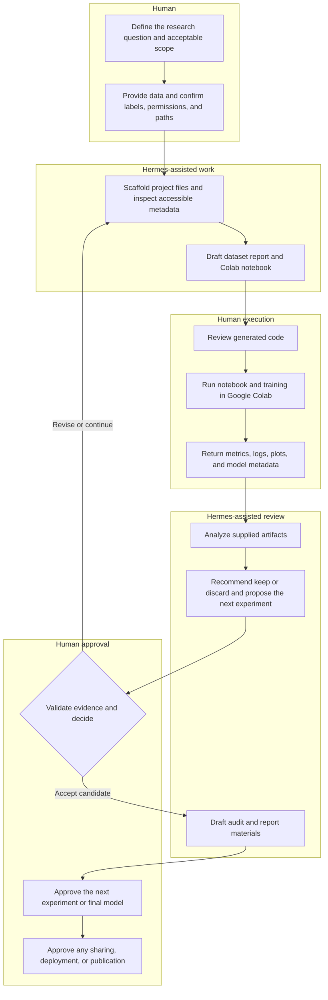

<div align="center">

# Hermes AutoResearch Workflow

**From Research Ideas to Structured, Reproducible Workflows.**


A repository of Markdown prompts, checklists, templates, and supporting guidance for a human-supervised machine-learning research workflow with Hermes Agent.

</div>

> [!IMPORTANT]
> This repository is **workflow documentation, not a software package**. There is no package to install, no automatic Hermes skill installation, and no training or deployment engine. The prompts can guide Hermes in preparing and reviewing work, but a human supplies the data, runs notebooks and training (for example, in Google Colab), validates the evidence, and approves every consequential decision.

## Why

Machine-learning experiments can become difficult to audit when objectives, data checks, notebook versions, metrics, and model decisions are recorded inconsistently. This workflow provides a repeatable sequence for moving from a research idea to documented artifacts while keeping people responsible for scope, execution, interpretation, and publication.

It is designed around a simple loop:

```text
Goal → Scope → Inspect → Generate → Run → Verify → Keep/Discard → Log → Repeat
```

The repository focuses on image-classification research, but its Markdown materials can be adapted to adjacent supervised-learning projects when the assumptions and evaluation criteria are reviewed by a knowledgeable human.

## What You Can Do

Using the materials in this repository, you can:

- define a project scope, paths, classes, candidate models, and primary metric;
- scaffold a consistent research-project structure;
- plan dataset inspection for class balance, file validity, duplication, and leakage risks;
- ask Hermes to draft Google Colab notebooks for baseline, transfer-learning, fine-tuning, and inference workflows;
- document metrics, confusion matrices, classification reports, training curves, and other artifacts;
- ask Hermes to analyze artifacts that you provide and recommend whether to keep or discard an experiment;
- audit a candidate final model against explicit quality checks; and
- draft a final report, executive summary, artifact index, and project README.

These are assisted documentation and analysis activities. Hermes recommendations are proposals for human review—not approvals, ground truth, or automatically executed actions.

## Workflow and Responsibilities



**Hermes can help:** scaffold within the authorized project folder, inspect accessible files and artifacts, draft notebooks, summarize results, recommend keep/discard decisions, and draft reports.

**The human must:** provide and govern the data, validate the research scope and labels, review generated code, run notebooks and training in Google Colab, verify results, approve model decisions, and authorize deployment or publication.

## Repository Tree

```text
.
├── .gitattributes
├── .gitignore
├── ACKNOWLEDGEMENTS.md
├── CONTRIBUTING.md
├── LICENSE
├── README.md
├── SECURITY.md
├── THIRD_PARTY_NOTICES.md
├── checklists/
│   ├── README.md
│   ├── dataset-readiness-checklist.md
│   ├── experiment-quality-checklist.md
│   ├── final-audit-checklist.md
│   └── keep-discard-decision-checklist.md
├── docs/
│   ├── README.md
│   ├── hermes-autoresearch-methodology.md
│   └── quick-start-guide.md
├── examples/
│   ├── README.md
│   └── synthetic-plant-image-classification.md
├── prompts/
│   ├── README.md
│   ├── 01_project_initialization_prompt.md
│   ├── 02_dataset_inspection_prompt.md
│   ├── 03_baseline_notebook_prompt.md
│   ├── 04_baseline_analysis_prompt.md
│   ├── 05_transfer_learning_prompt.md
│   ├── 06_transfer_learning_analysis_prompt.md
│   ├── 07_finetuning_prompt.md
│   ├── 08_final_audit_prompt.md
│   ├── 09_predict_deployment_prompt.md
│   └── 10_google_docs_final_report_prompt.md
├── templates/
│   ├── README.md
│   ├── README-project-template.md
│   ├── artifact-index-template.md
│   ├── baseline-analysis-template.md
│   ├── dataset-inspection-template.md
│   ├── final-audit-template.md
│   ├── final-report-template.md
│   └── transfer-learning-analysis-template.md
└── tools/
    ├── audit_publication.py
    └── validate_markdown.py
```

## Quick Start

No installation command is required. These are ordinary Markdown files; opening or copying a prompt does not install a Hermes skill and does not execute training.

1. **Clone the repository.** While it is private, you need access granted by the owner. If it is later made public, anyone can use the same command:

   ```bash
   git clone https://github.com/rifkiilhambaihaki/hermes-autoresearch-workflow.git
   cd hermes-autoresearch-workflow
   ```

2. **Read the workflow.** Start with the [methodology](docs/hermes-autoresearch-methodology.md) and [quick-start guide](docs/quick-start-guide.md). The supporting documents are currently written in Indonesian; the prompt filenames and this README provide the English navigation layer.
3. **Create an isolated project location.** Choose explicit Google Drive and local project paths. Do not point the workflow at unrelated, production, credential, or system directories.
4. **Customize Prompt 01.** Replace every placeholder in [Project Initialization](prompts/01_project_initialization_prompt.md), including project name, problem type, data type, class list, paths, candidate models, primary metric, and dataset notes.
5. **Review before acting.** Give the customized prompt to Hermes, inspect the proposed structure, and approve only operations inside the intended project folders.
6. **Supply and inspect the data.** Keep the original dataset unchanged. Use Prompt 02 and the dataset-readiness checklist before requesting notebook generation.
7. **Generate, review, and run notebooks.** Use Prompts 03, 05, and 07 as relevant. A human reviews the code and runs it in Google Colab; this repository and Hermes do not execute training automatically.
8. **Return artifacts for analysis.** Provide real logs, metrics, plots, reports, and model metadata to Hermes. Use Prompts 04, 06, and 08 to structure analysis and audit. Do not ask Hermes to infer missing results.
9. **Make the decision yourself.** Treat keep/discard and final-model recommendations as advisory. Record the rationale and obtain the required human approval.
10. **Draft inference and reporting materials.** Prompts 09 and 10 can help draft an inference/testing notebook and report. Prompt 09 does **not** automatically deploy a model.

## Fully Synthetic Example

See [Synthetic Plant Image Classification](examples/synthetic-plant-image-classification.md) for a fictional, non-clinical walkthrough of the workflow. It is an instructional example, not a real dataset result, benchmark, trained model, or claim of performance. Use it to understand how placeholders, human handoffs, artifacts, and approval gates fit together; do not treat its illustrative content as experimental evidence.

## Prompt Library

Use the prompts in order unless a reviewed project plan justifies skipping a stage:

1. [Project Initialization](prompts/01_project_initialization_prompt.md) — define scope, paths, structure, and safeguards.
2. [Dataset Inspection](prompts/02_dataset_inspection_prompt.md) — examine dataset organization and quality risks.
3. [Baseline Notebook](prompts/03_baseline_notebook_prompt.md) — draft a baseline Google Colab notebook.
4. [Baseline Analysis](prompts/04_baseline_analysis_prompt.md) — review baseline artifacts and metrics.
5. [Transfer Learning](prompts/05_transfer_learning_prompt.md) — draft a transfer-learning experiment notebook.
6. [Transfer-Learning Analysis](prompts/06_transfer_learning_analysis_prompt.md) — compare supplied experiment evidence and recommend keep/discard.
7. [Fine-Tuning](prompts/07_finetuning_prompt.md) — draft a controlled fine-tuning notebook.
8. [Final Audit](prompts/08_final_audit_prompt.md) — review completeness, consistency, and the candidate model decision.
9. [Predict/Deployment Notebook](prompts/09_predict_deployment_prompt.md) — draft an inference/testing notebook; it does not perform automatic deployment.
10. [Google Docs Final Report](prompts/10_google_docs_final_report_prompt.md) — organize the final report and artifact links.

## Checklists and Templates

### Checklists

- [Dataset Readiness Checklist](checklists/dataset-readiness-checklist.md)
- [Experiment Quality Checklist](checklists/experiment-quality-checklist.md)
- [Keep/Discard Decision Checklist](checklists/keep-discard-decision-checklist.md)
- [Final Audit Checklist](checklists/final-audit-checklist.md)

### Templates

- [Project README Template](templates/README-project-template.md)
- [Artifact Index Template](templates/artifact-index-template.md)
- [Dataset Inspection Template](templates/dataset-inspection-template.md)
- [Baseline Analysis Template](templates/baseline-analysis-template.md)
- [Transfer-Learning Analysis Template](templates/transfer-learning-analysis-template.md)
- [Final Audit Template](templates/final-audit-template.md)
- [Final Report Template](templates/final-report-template.md)

## Reproducibility and Human Oversight

A reproducible record should connect each conclusion to the exact data state, code, configuration, environment, and artifact that produced it. At minimum:

- preserve original data and document provenance, permissions, class definitions, exclusions, and split logic;
- record random seeds, dependency and runtime versions, hardware/runtime type, preprocessing, augmentation, hyperparameters, and stopping criteria;
- use immutable experiment identifiers and retain notebook versions, logs, metric files, plots, and model metadata;
- separate train, validation, and test data, and investigate duplicates or subject/group leakage before training;
- define the primary metric and acceptance criteria before comparing candidates;
- report class-aware measures—not accuracy alone—including macro and weighted precision, recall, F1, confusion matrices, and stability where appropriate;
- distinguish observed evidence from interpretation, recommendation, and unresolved uncertainty; and
- require a human to reproduce or independently verify decisive results before selecting a model or publishing a claim.

A Hermes-generated notebook or report is a draft. Humans remain accountable for data governance, code review, compute use, statistical validity, domain interpretation, safety review, and all release decisions.

## Customization

Replace the placeholders in each prompt rather than using them verbatim:

- `{Nama Project}` — project name;
- `{Jenis Masalah}` — problem type;
- `{Jenis Data}` — data type;
- `{Daftar Kelas}` — expected classes;
- `{Path Google Drive}` and `{Path Lokal VPS}` — explicitly authorized project locations;
- `{Model Yang Dicoba}` — candidate models;
- `{Metrik Utama}` — preselected primary metric; and
- `{Catatan Khusus Dataset}` — provenance, grouping, exclusions, imbalance, or other constraints.

You may adapt folder names, metrics, model families, and report sections, but preserve the separation between human execution and Hermes-assisted review. If a required fact is unavailable, mark it as needing confirmation rather than inventing it. For non-image or high-stakes domains, revise the inspection, evaluation, and approval gates with appropriate subject-matter expertise before use.

## Limitations and Safety Boundaries

- **No autonomous training:** the repository contains no training runner, scheduler, or experiment agent.
- **No heavy training on a VPS:** generated training work is intended to be reviewed and run by the human in an appropriate environment such as Google Colab.
- **No automatic skill installation:** cloning, downloading, or reading this repository does not add a Hermes skill or modify Hermes configuration.
- **No automatic deployment:** the predict/deployment prompt drafts an inference/testing notebook; deployment requires a separate, human-approved engineering and safety process.
- **No clinical use:** outputs are research prototypes and must not be used for diagnosis, treatment, or independent clinical decision-making.
- **No guaranteed correctness or reproducibility:** prompts, generated code, artifact analyses, and model recommendations can be incomplete or wrong. Verify them against source artifacts and rerun critical work.
- **No substitute for governance or expertise:** users must address consent, licensing, privacy, security, bias, statistical validity, and domain-specific regulation.
- **No safe conclusion from missing artifacts:** a report cannot establish performance when underlying data, code, logs, or evaluation outputs are absent.

## Available Now vs. Roadmap

### Available now

- 10 ordered Markdown prompts covering initialization through final reporting;
- 4 review checklists and 7 reporting/documentation templates;
- methodology and quick-start documentation;
- a human-in-the-loop workflow for Hermes-assisted scaffolding, notebook drafting, artifact review, recommendations, and reporting;
- a fully synthetic plant image-classification walkthrough; and
- an optional standard-library publication-audit utility for detecting common sensitive or unsuitable files. This utility is a repository hygiene check, not a training engine or installable package.

### Roadmap / proposals, not current capabilities

- English versions of the supporting methodology and quick-start documents;
- additional fully synthetic, non-clinical examples;
- clearer machine-readable artifact conventions and optional validation utilities; and
- further domain-adaptation guidance and review gates.

Roadmap items are not commitments. They do not imply autonomous training, automatic deployment, or automatic Hermes skill installation.

## Contributing

Contributions that improve clarity, reproducibility, safety boundaries, templates, or synthetic examples are welcome. Before proposing a change:

1. keep examples synthetic and remove personal, confidential, credential, proprietary, and real subject data;
2. do not add performance claims without reproducible public evidence;
3. preserve explicit human approval gates and the no-autonomous-training boundary;
4. keep relative links valid and update the repository tree when files change;
5. explain the purpose and expected workflow impact of the change; and
6. verify that prompts cannot silently modify original datasets or access unrelated directories.

Use the repository's normal issue or pull-request process when available. A contribution should not present planned functionality as already implemented.

See [CONTRIBUTING.md](CONTRIBUTING.md) for the repository contribution process and [SECURITY.md](SECURITY.md) for responsible reporting guidance.

## License

This repository is available under the [MIT License](LICENSE). Refer to that file for the governing terms.

The projects acknowledged below use their own licenses. Their licenses do not automatically apply to this independent repository.

## Acknowledgements and Disclaimer

This workflow draws conceptual inspiration from [uditgoenka/autoresearch](https://github.com/uditgoenka/autoresearch) and is designed for use with [NousResearch/hermes-agent](https://github.com/NousResearch/hermes-agent). Both upstream projects identify the MIT License in their respective repositories. Review their current repositories and license files for authoritative terms. Additional attribution details are recorded in [ACKNOWLEDGEMENTS.md](ACKNOWLEDGEMENTS.md) and [THIRD_PARTY_NOTICES.md](THIRD_PARTY_NOTICES.md).

This is an independent community workflow. It is not affiliated with, endorsed by, or an official component of uditgoenka/autoresearch, Nous Research, Hermes Agent, Google, Google Drive, or Google Colab.

The materials are provided for research and educational workflow support. They are not medical, legal, regulatory, or production-deployment advice. You are responsible for validating generated content, protecting data, complying with applicable rules and licenses, controlling compute and costs, and deciding whether any result is suitable to share or use.
